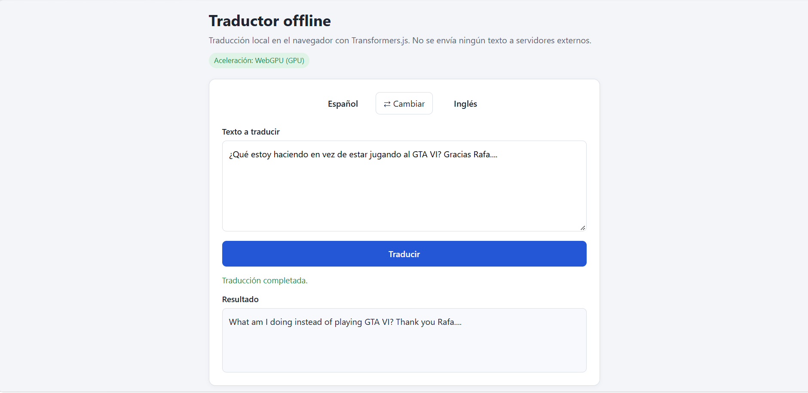

# 🌍 Panel de atención al cliente con IA

Prueba de concepto para una empresa de comercio internacional con clientes que escriben en español e inglés. Tiene dos partes:

| Parte | Qué hace | Tecnología |
|---|---|---|
| 🖥️ **Frontend** | Traductor inglés ⇄ español que funciona en el propio navegador, sin coste de API | Transformers.js (Hugging Face) |
| ⚙️ **Backend** | Clasifica la consulta de un cliente y redacta un borrador de respuesta | Python + Gemini |

---

## 📁 Estructura

```
├── index.html        # Interfaz del traductor
├── style.css         # Estilos
├── app.js            # Lógica del traductor (Transformers.js)
├── backend.py        # Servicio de soporte con Gemini
├── requirements.txt  # Dependencias de Python
├── .env.example      # Plantilla de configuración
├── .gitignore
└── captura.png       # Captura del frontend
```

---

## 🖥️ Frontend: traductor offline

Traduce borradores y tickets **dentro del navegador**. Los modelos se descargan la primera vez y después se ejecutan en el equipo del usuario, así que cada traducción no genera costes ni carga en el servidor.

- **Modelos:** `Xenova/opus-mt-en-es` (inglés → español) y `Xenova/opus-mt-es-en` (español → inglés).
- **Aceleración:** usa **WebGPU** si el navegador lo permite y, si no, **WASM**.
- **Estados:** muestra "Cargando modelo..." con porcentaje, "Traduciendo..." y "Modelo listo".



### ▶️ Cómo ejecutarlo

Hay que abrirlo con un servidor local, no haciendo doble clic en el HTML:

```bash
python -m http.server 8000
```

Después abre **http://localhost:8000** en Chrome o Edge.

> La primera carga tarda un poco porque descarga el modelo. Las siguientes son instantáneas porque el navegador lo guarda en caché.

---

## ⚙️ Backend: servicio de soporte técnico

Recibe el mensaje de un cliente (en español o inglés) y devuelve un **JSON estricto** con:

| Campo | Valores posibles |
|---|---|
| `categoria` | `incidencia_envio`, `devolucion`, `consulta_producto`, `otro` |
| `prioridad` | `alta`, `media`, `baja` |
| `respuesta_sugerida` | Borrador de respuesta cordial en español |

- **Librería oficial `google-genai`** con el modelo ligero `gemini-3.1-flash-lite`.
- **JSON Schema** (`response_schema` con `enum`), para que Gemini solo pueda devolver valores permitidos.
- **Reintentos con retroceso exponencial y jitter** ante errores temporales (429, 500, 502, 503 y 504), con un máximo de 5 intentos.

### 🔧 Instalación

1. Crea y activa un entorno virtual (opcional, pero recomendado):

   ```bash
   python -m venv .venv
   source .venv/Scripts/activate      # Windows (Git Bash)
   # .venv\Scripts\activate           # Windows (CMD / PowerShell)
   # source .venv/bin/activate        # Linux / macOS
   ```

2. Instala las dependencias:

   ```bash
   pip install -r requirements.txt
   ```

3. Copia `.env.example` como `.env` y pon tu clave de [Google AI Studio](https://aistudio.google.com/apikey):

   ```
   GEMINI_API_KEY=tu_api_key_aqui
   ```

### ▶️ Cómo ejecutarlo

Con un mensaje directo:

```bash
python backend.py "My package arrived broken"
```

O en modo interactivo (escribe `salir` para terminar):

```bash
python backend.py
```

### 📤 Ejemplo de salida

```json
{
  "categoria": "incidencia_envio",
  "prioridad": "alta",
  "respuesta_sugerida": "Sentimos mucho saber que su pedido ha llegado en mal estado. Por favor, facilítenos su número de pedido y una fotografía de los daños para que podamos tramitar una solución inmediata para usted."
}
```

---

## 🔒 Seguridad

- La API key **solo** se lee desde el archivo `.env` con `python-dotenv`.
- El `.env` está en el `.gitignore` y **no se sube** al repositorio.
- La clave **nunca llega al navegador**: el frontend no usa Gemini, solo el backend.
- `.env.example` muestra cómo configurar la variable sin incluir ninguna clave real.
